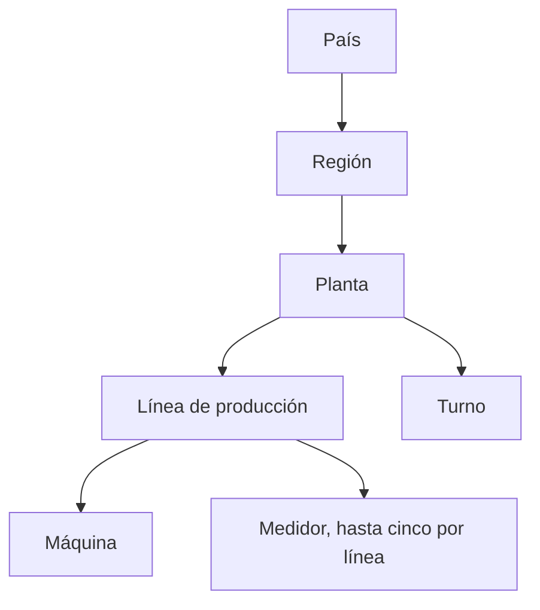
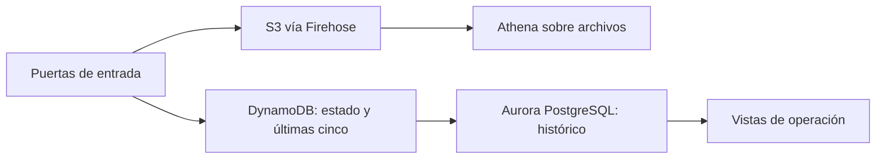
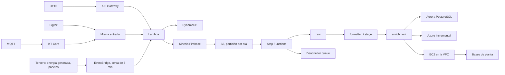
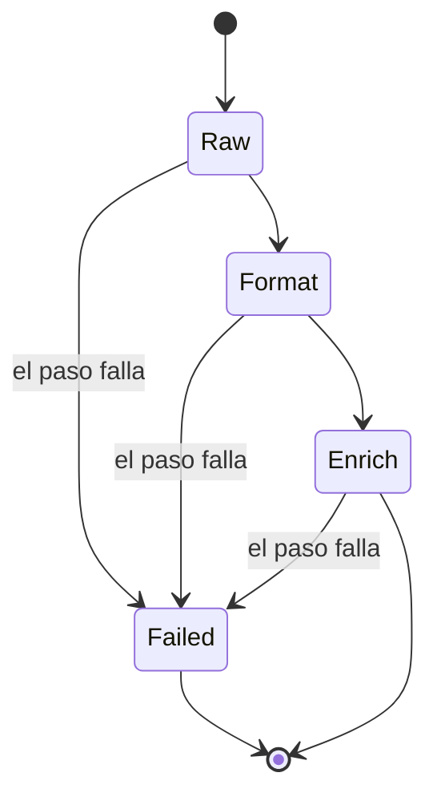
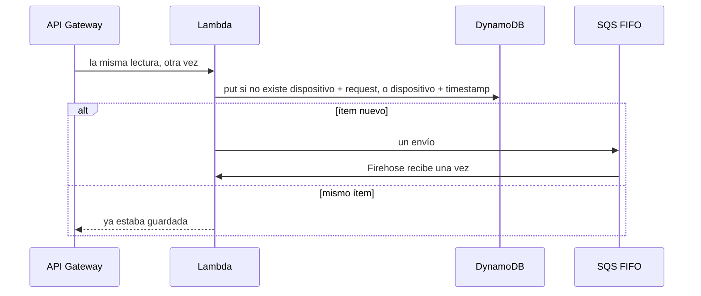
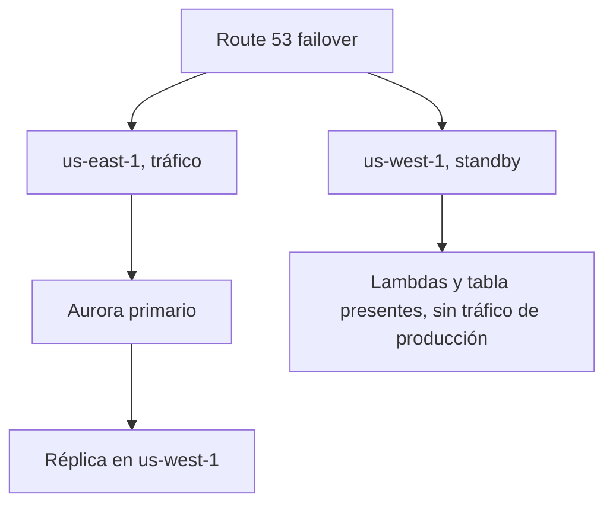

# Serverless IoT data pipeline

Arquitectura de un pipeline de lecturas de planta. Varias puertas entran, un esquema sale. Este repositorio no es el código de las cuentas y no trae ids, dominios ni credenciales.

La escala que cabe en esta descripción: empezó en unos cinco dispositivos, una línea podía tener cerca de 20, una planta 2 líneas o cerca de 12, y el orden de magnitud en vuelo era cerca de 10,000 dispositivos. Diez mil es un conteo de dispositivos, no de plantas. La ingesta era seguida, cerca de una lectura por segundo.

## Jerarquía

El grano operativo es este. Sección y organización no son niveles de este modelo. El turno sí.

La máquina y el medidor no son el mismo objeto.

Un mensaje a veces trae tres máquinas juntas. Eso se parte con la configuración del dispositivo. La palabra es split.

Una línea puede tener hasta cinco medidores. Cada uno tiene su cadencia, de un minuto, cinco o quince, y su tipo de lectura. Algunos números dependen de otro dispositivo. No mezclar el paquete de tres máquinas con los cinco medidores de la línea.

Hay medidor de planta y medidores de línea. Las áreas que no tienen medidor propio salen de restar las líneas conocidas al medidor de planta. Solo se divide un número cuando la configuración lo dice.

## Clasificación del recurso

La unidad no venía canónica. El tipo de recurso y la unidad vivían en la metadata del dispositivo, no en una rama del código.

- Gas: kilos o litros. Gas natural o LP. Son recursos distintos.
- Agua: litros, metros cúbicos, o cientos de litros. El factor numérico de "cientos" no está en este repositorio.
- También entraban energía, electricidad, masa y envolturas.

La regla nueva era una fila de metadata, no un deploy. El alta del dispositivo se hacía en la pantalla de la planta y se sincronizaba al controlador central.

## Qué número es cada lectura

Hay dos tipos. La metadata dice cuál es.

| Tipo | Qué significa el valor | Qué se guarda |
| --- | --- | --- |
| Acumulado | Lo que el medidor marca. 500 a las 4:00 y 600 a las 4:10. | El acumulado y el delta. El delta de ese tramo es 100. |
| Intervalo | El valor ya es el consumo del tramo. El de las 4:10 no incluye lo anterior. | Ese valor como delta. No se resta contra el vecino. |

El desorden se resuelve con el timestamp, no con el orden de llegada. DynamoDB guarda las últimas cinco mediciones del dispositivo. Si llega un valor menor, no se toma como consumo hacia atrás. Se mira el timestamp, se intercala entre esas cinco y se marca con bandera. Luego se recalculan las diferencias entre vecinos.

Un valor menor con un timestamp más nuevo puede ser un reset del medidor. Esa regla no está descrita aquí.

Una lectura más vieja que las cinco que ya se conservan no entra en la ventana. No hay otra política escrita para ese caso.

La función está en `lambdas/rules.js`.

## DynamoDB: qué guarda y cómo se lee

No es el warehouse. Guarda la configuración del dispositivo, el estado, la lectura reconciliada y las últimas cinco mediciones. Esas dos, la lectura reconciliada y el estado, no se podían perder entre sincronizaciones. El histórico que se consulta vive en Aurora PostgreSQL. Los archivos viven en S3.

La llave de la medición es el id del dispositivo más el id del request de API Gateway. Cada dispositivo que manda mediciones tiene su propio id. Una puerta que no trae request, MQTT o el cron, usa el mismo id de dispositivo más el timestamp. El hardware no emitía dos mediciones distintas del mismo dispositivo en el mismo milisegundo. Una segunda ejecución con esa misma pareja cae en el mismo ítem. Eso es la idempotencia. La cola FIFO usa esa misma pareja como id de deduplicación. La ventana de la cola es de cinco minutos.

Los índices existen para consultar la jerarquía y los datos ya agregados. La pregunta es cuáles dispositivos pertenecen a un país, una región, una planta o una línea, y cuál es el total de ese grupo. El nombre del atributo de cada índice no está escrito. El stream de la tabla es una creencia para verificar que el ítem calculado había quedado escrito, no un hecho cerrado.

| Consulta | Para qué | Dónde cae |
| --- | --- | --- |
| Esta medición | Idempotencia y el punto en la serie | Tabla base, dispositivo + request, o dispositivo + timestamp |
| Dispositivos de un grupo | País, región, planta o línea | Índice de la jerarquía |
| Total del grupo | Cuánto consumió ese grupo en el periodo | Índice del agregado, y el mismo total en S3 y en PostgreSQL |
| Últimas cinco | Intercalar un acumulado tarde y recalcular deltas | Las cinco del dispositivo. El sort key exacto no está escrito |
| Configuración | Split, hex a decimal, factor, unidad, acumulado o intervalo, cadencia, lugar en la jerarquía | Fila de metadata del dispositivo |
| Estado y último visto | Tablero de silencio a las 3, 6, 12 y 24 horas | Estado del dispositivo. El índice de esa consulta no está escrito |

## Suma por grupo

Una planta puede no tener un medidor propio. El total de esa planta es la suma de sus medidores: veinte medidores, en diez máquinas, en cuatro líneas. El índice dice cuáles entran. La operación que se repite suma sus deltas. El histórico y el delta llegan combinados; lo que se suma para el consumo del periodo es el delta, porque el acumulado es la marca del medidor, no el consumo del grupo.

Ese total se guarda en S3 y en el histórico de PostgreSQL. La consulta de operación lee el total ya escrito. No recorre los veinte medidores en cada pregunta.

Cuando sí hay medidor de planta, ese medidor no se suma encima de los medidores de línea. Las áreas sin medidor propio salen de restar las líneas conocidas al medidor de planta. Sumar los dos contaría dos veces.

La lectura por defecto de DynamoDB es eventualmente consistente. Dos lotes pueden traer el mismo minuto: un lote era de unas 60 filas y podía incluir un minuto que otra Lambda ya había procesado. El punto encuentra su lugar por timestamp dentro de las cinco, no por un candado distribuido. Una lectura fuertemente consistente de esas cinco sería la forma segura de no calcular el delta con una ventana vieja. No está escrito que la consola tuviera `ConsistentRead` prendido.

## Consistencia del resto del camino

Firehose amortigua y S3 aparece después. Athena ve el archivo cuando el objeto ya está, así que esa lectura es eventual. Por eso el histórico de operación que había que consultar rápido no se quedó en el escaneo de archivos: se guardó en Aurora PostgreSQL, y ese cluster se tuvo que crecer. Azure recibía un sync incremental por el cupo de conexiones.

La tabla de DynamoDB del oeste existía porque el stack ya estaba levantado. No está escrito si se replicaba con streams o con una global table. El tráfico de producción no escribía ahí. La réplica que sí movía datos era la de Aurora.

## Patrones

Es una arquitectura serverless dirigida por eventos, y no es solo eso.

- Eventos en las puertas. MQTT, HTTP y un schedule de cerca de cinco minutos empujan trabajo al mismo flujo. El schedule llama a un servicio de un tercero: energía generada por paneles solares. Nadie deja un servidor esperando.
- Orquestación del lote. Step Functions recorre raw, formatted/stage y enrichment. Si un paso falla, ese paso falla. El anterior ya dejó la lectura. La dead-letter queue recibe el fallo.
- Reglas en datos. La variación del medidor es una fila, no un cambio de código.
- Consumidor idempotente. La llave es el id del dispositivo más el id del request de API Gateway, o el id del dispositivo más el timestamp en las otras puertas. La causa de la doble ejecución no está escrita. La cola FIFO deduplica con esa misma pareja. La ventana de la cola es de cinco minutos.
- Almacenes separados por acceso. DynamoDB es el estado caliente. S3 es el archivo. Aurora es el histórico. No es una sola tabla para todo.
- Standby tibio. us-east-1 atiende. us-west-1 ya está desplegado y no recibe el tráfico. Route 53 conmuta el nombre de la API. Los schedules del oeste no deben dispararse solos, porque un failover de DNS no mueve un EventBridge.

No hay un outbox descrito. No hay una saga con compensaciones de negocio descrita. El reset del medidor no tiene regla.

## Escalabilidad

Escala por invocación. Agregar plantas no agranda un cluster de cómputo. Cada Lambda es un paso, así que un fallo no se lleva el flujo entero.

El cuello que sí apareció no fue la concurrencia de Lambda. Fue el tamaño de Aurora, que hubo que crecer, y el cupo de conexiones hacia Azure, por eso el sync era incremental. La comparación contra una sola instancia, Elastic Beanstalk o un contenedor se hizo con el reporte de uso, el tiempo de dejar esa instancia tan tolerante como el pipeline, y el costo. El monto y el tamaño de instancia no están aquí.

El arranque en frío dejó de ser parte del diseño porque la ingesta era seguida. No hay un número de concurrencia reservada en esta descripción.

## Energía generada y consumida

Las tres puertas se combinan en un solo esquema: MQTT, API Gateway y el cron de EventBridge.

Ese cron pide a un tercero la energía generada por paneles solares. En el mismo pipeline también entra la energía consumida, medida. No hacía falta calcular el consumo para tenerlo: las dos series ya llegaban. Con los datos sí se podía calcular. Un acumulado deja el delta del tramo, y ese camino ya está en `placeCumulative`. Para esta energía el cálculo estaba preparado y no era el que se usaba para obtener el consumo, porque el consumo ya venía.

## Flujo

Las bases de planta no se alcanzaban desde la Lambda. El EC2 dentro de la VPC era el puente.

La partición del archivo es el día del dato, para que Athena no recorra el bucket entero. El registro de la partición nueva es parte del paso que ya escribió el objeto. `MSCK REPAIR` sobre una tabla grande es el camino lento. La proyección de particiones del catálogo evita ese repair. Cuál de las dos estaba en la consola no está escrito. El síntoma que sí está escrito es otro: una consulta histórica sobre los archivos tardaba 26 segundos, y la lectura de operación pasó a Postgres.

## Step Functions y deduplicación

## Disaster recovery

El hostname único, si lo había, vivía delante de las dos APIs. Cada API regional conserva su URL de execute-api. Un failover de Route 53 mueve el nombre cuando la sonda HTTPS contra `/live/health` de Virginia falla. No mueve los schedules. En este repositorio la sonda es cada 30 segundos y falla al tercer intento. Ese intervalo no es el de la consola: no estaba escrito.

## Stacks y pipeline

Este repositorio vive en GitHub, así que el pipeline es GitHub Actions, en `.github/workflows/pipeline.yml`. Cada push corre las pruebas y `cdk synth`. El deploy es un disparo manual: Actions asume un rol con OIDC y CDK aplica CloudFormation. No hay llaves en el repo. Los secretos del deploy son `AWS_ROLE_ARN` y `PARTNER_URL`.

En el trabajo el push era GitLab. Ese runner no se copia aquí, porque este código no está en GitLab. CloudFormation sigue siendo quien crea los recursos. Son dos stacks:

| Stack | Región | Qué hace |
| --- | --- | --- |
| PipelineEast | us-east-1 | Atiende. Cron, regla MQTT y tablero de silencio prendidos. Crea el clúster global de Aurora y el puente EC2. |
| PipelineWest | us-west-1 | Ya está desplegado. Cron, regla MQTT y silencio apagados. Se une al clúster global como réplica. No hay puente EC2. |

La tabla de DynamoDB de cada stack es regional. Este template no declara streams ni una global table. Los nombres `groupKey`, `memberId`, `by-group` y `by-time` son el modelo de este repositorio. El LSI `by-time` comparte el dispositivo y ordena sus mediciones. El GSI `by-group` responde la jerarquía y el total del grupo. El atributo de producción no está escrito.

El orden de deploy es este. Primero el este, que crea el clúster global. Después el oeste, que se une. Al final, otra vez el este con `HostedZoneId`, `RecordName` y `WestApiHost`: ahí aparecen los dos registros de failover. Sin esos tres valores el stack del este no crea DNS.

Los números de memoria, timeout, ACU, el tipo de la instancia puente y la sonda están en `lib/config.ts`.

## Qué no está en este repositorio

La causa de la doble ejecución, el nombre de producción del atributo en el GSI y en el LSI, streams contra global table, el certificado del dispositivo, el factor numérico de cada unidad, y el intervalo real de la sonda.
